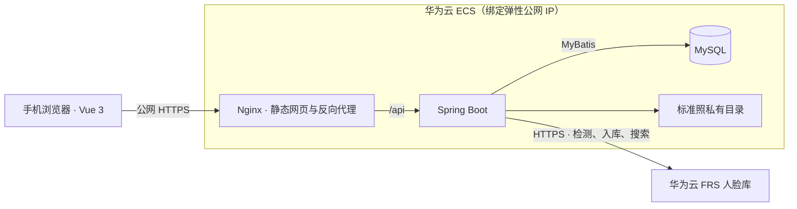

# 基于华为云的人脸签到系统 · 简要设计

云计算课程大作业｜第一次提交｜2026 年 11 月 24 日

| 团队成员 | 学号 | 主要分工 |
| --- | --- | --- |
| 曾杨洋 | 241250081 | Vue 3 手机页面、拍照与相册上传、照片库和考勤记录界面 |
| 张靖宇 | 241250073 | Spring Boot 接口、MyBatis 与 MySQL、华为云 FRS 接入和 ECS 部署 |

两人共同确定接口、进行真机联调，并完成并发测试和课程演示。

## 1. 使用场景与权限

学生在手机浏览器中打开云服务器的公网地址，即可注册或拍照打卡。任意手机都可以供多人轮流使用。签到者的身份由服务器根据本次照片检索确定，打卡请求只携带照片和请求编号，无需登录或选择姓名。

| 使用者 | 页面与操作 |
| --- | --- |
| 访客 | 注册时填写姓名、学号、密码，现场拍摄或从相册选择一张标准照，预览后提交；在首页点击「拍照打卡」并查看本次结果。 |
| 已登录学生 | 查看、更换或删除本人的标准照，按日期查看本人的签到与签退时间，退出登录。删除标准照后须重新录入才能继续打卡，已有考勤记录保留。 |
| 已登录管理员 | 按学号查询和管理全员照片库，按日期及人员查看考勤记录。服务端校验管理员角色；公开注册仅创建学生账号。 |

## 2. 系统架构与部署

手机通过同一地址加载网页并上传照片。注册页分别提供拍照和相册入口，打卡页调起系统相机，拍完后回到网页查看反馈。部署时为实际访问地址配置匹配的 HTTPS 证书，用真机验证拍照和上传。MySQL 仅监听内部地址。FRS 凭据由后端读取，标准照通过鉴权接口访问。只保留用户同意录入的标准照，打卡现场照在请求处理结束后清理，日志只记录请求编号、耗时和结果类型。

## 3. 模型选择与识别流程

采用**华为云人脸识别服务（FRS）的托管识别能力**。人脸检测接口定位图中人脸；添加人脸接口提取标准照特征并存入指定人脸库；人脸搜索接口对现场照提取特征，在同一库内进行 **1:N 检索**，返回候选人的 `face_id` 和相似度。该方式适合从全班已录入人员中确定身份，ECS 负责业务逻辑，模型推理由 FRS 承担。选型依据为服务公开的接口能力，底层网络结构和权重由服务方管理。[华为云 FRS API 概览](https://support.huaweicloud.com/api-face/face_02_0052.html) · [人脸搜索接口](https://support.huaweicloud.com/intl/zh-cn/api-face/face_02_0035.html) · [特征存储说明](https://support.huaweicloud.com/productdesc-face/face_01_0024.html)

**注册与建库。** 服务器校验学号、图片格式和大小，并调用 FRS 检测。恰好检测到一张脸才继续；无人脸或多人脸时，请用户重拍。入库成功后，在 MySQL 中关联内部用户 ID、有效的 `face_id` 和标准照路径，返回注册成功。更换照片时先录入新照，再切换有效映射并清理旧照及旧特征。如果数据库提交失败，回收本次新增的文件和云端人脸；清理失败时记录标识以便重试。识别结果只接受本地仍有效的映射。允许不同学号分别录入相似人脸，身份歧义在打卡时处理。

**匿名打卡。** 服务器记录请求到达时间，检查现场照中恰好有一张脸，再调用 FRS 搜索。比较不同用户的有效候选人。最高分达到识别阈值且能与其他人区分时，写入一条打卡明细，返回脱敏姓名及当日签到、签退状态。若前两人均达标但分差小于区分阈值，则提示「无法区分相似人员，请重拍」，不写考勤。没有达标候选人时显示「未识别到已录入人员」；FRS 超时或不可用时显示「识别服务暂不可用，请重试」。这两种结果均不写入有效考勤。联调时用已录入成员的新照片、未录入人员照片及相似候选样本，检验识别阈值和区分阈值，记录误认和拒识情况。请求字段、状态码和响应示例见[前后端 REST API 文档](./REST-API.md)。

## 4. 数据与考勤规则

| MySQL 表 | 核心字段 | 约束与用途 |
| --- | --- | --- |
| `users` | 用户 ID、学号、姓名、密码哈希、角色 | 学号唯一；登录后由服务端会话确定身份，退出登录时使会话失效。 |
| `face_photos` | 用户 ID、FRS 人脸 ID、标准照路径、更新时间 | 用户 ID 和人脸 ID 分别唯一，每人最多保留一张当前标准照。 |
| `checkins` | 打卡 ID、用户 ID、请求编号、服务器接收时间 | 请求编号唯一；按用户和接收时间建索引，支持查询每日有效明细。 |

**每日规则。** 一次现场拍摄对应一个请求编号，网络重试沿用该编号。系统按北京时间的自然日筛选有效明细：签到取最早时间；仅有一条时显示「待签退」；达到两条后签退取最晚时间。后续打卡仍可更新签退。按服务器接收时间归属日期，即使识别等待跨过零点，也计入拍照请求到达时所在的日期。

| 同一人员当天的有效打卡 | 页面显示的签到 | 页面显示的签退 |
| --- | --- | --- |
| 08:30 | 08:30 | 待签退 |
| 08:30、12:10 | 08:30 | 12:10 |
| 08:30、12:10、18:05 | 08:30 | 18:05 |

## 5. 高并发处理与验证

集中签到时，每个合格的打卡请求都会调用检测和搜索两个接口。后端按账号在部署区域的实际接口配额分别限速，限制同时处理的图片数和等待队列长度，并为云调用设置超时。队列满时返回 HTTP 429，手机提示稍后重试。调用 FRS 期间不占用数据库事务；识别成功后用短事务写明细。若同一请求并发到达，数据库唯一约束只允许一次写入，重试返回已记录的结果。

第三周分两步验证：先用模拟 FRS 响应制造突发流量，检查队列是否有界、过载是否有反馈、相同请求是否只写一条；再在云端额度内使用真实照片完成端到端测试。分别记录请求数、成功数、限流数、服务错误数和第 95 百分位响应时间，并核对数据库有效明细数。模拟结果与真实云服务结果分别报告。

## 6. 三周交付与演示

| 阶段 | 交付及验收方式 |
| --- | --- |
| 第一周 · 设计 | 提交本设计，确定部署架构、FRS 选型、权限、打卡规则、并发方案与分工。 |
| 第二周 · 前后端联通 | 手机经公网完成注册、标准照上传、登录、查看照片和退出登录。提交手机页面截图，以及注册前后 MySQL 用户和照片映射的变化截图。 |
| 第三周 · 完整签到 | 先录入一名成员，再用另一人的手机为已录入成员拍照，展示首次签到、再次签退和登录后可见的最早／最晚记录；随后让尚未录入的成员用同一手机打卡，展示拒识且数据库有效记录数不变。提交手机反馈、记录页、服务器查询截图及并发验证结果。 |
